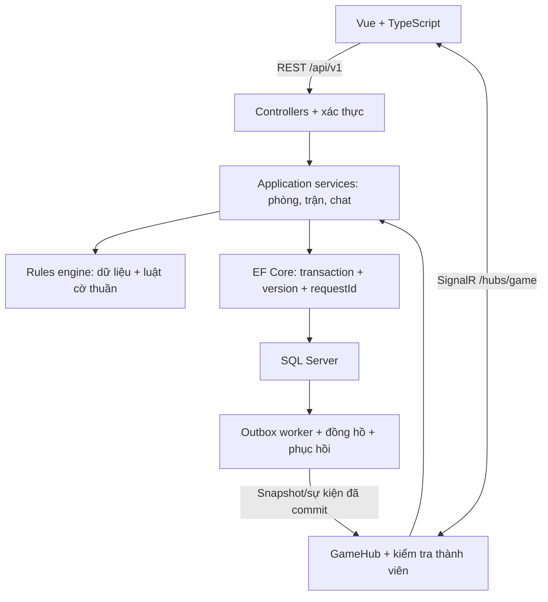
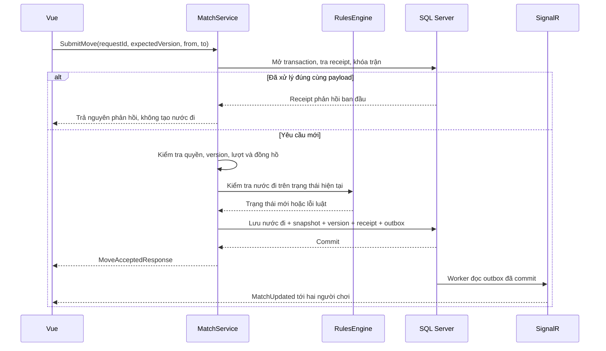

# GCT-20 — Kiến trúc hệ thống

Ngày thiết kế: 26/10/2026. Tác vụ: [GCT-20](https://vle2362005.atlassian.net/browse/GCT-20). Trạng thái: thiết kế đề xuất để trưởng nhóm review; chưa triển khai backend.

## 1. Căn cứ và phạm vi

| Căn cứ Jira | Quy ước được sử dụng |
|---|---|
| GCT-19 | Tài khoản, phòng hai người, luật cờ, chơi với máy, chat, lịch sử; phải xét mất mạng và khởi động lại |
| GCT-15 | Phòng chờ → sẵn sàng → đang chơi → kết thúc/đóng; đóng phòng không xóa trận |
| GCT-21 | Vue + ASP.NET Core; tách bộ luật, kiểm thử, tài liệu |
| GCT-25/26 | Tài khoản, phòng, thành viên, trận, nước đi; EF Core |
| GCT-42 | Cột 0–8, hàng 0–9; Đen trên, Đỏ dưới; bộ luật độc lập |

Bản hợp đồng này thiết kế giao tiếp PvP Version 1, gồm đầu hàng và hòa thỏa thuận. Chơi với máy, video và replay thuộc Version 2; undo, xếp hạng và khán giả chưa có trong phạm vi được chốt. Không thực hiện phân xử lặp thế/chiếu dai chuyên sâu trong v1; giao diện phải công bố giới hạn này.

Nguồn nghiệp vụ: [GCT-19 requirements.md](requirements.md), [rules.md](rules.md) và [GCT-15 lifecycle.md](lifecycle.md). Trạng thái Done cũ không được dùng làm bằng chứng triển khai. Các tài liệu và hợp đồng này cùng chờ trưởng nhóm review.

## 2. Sơ đồ thành phần

Đây là một backend có các module rõ ràng, phù hợp quy mô đồ án bảy người. Bộ luật nằm trong cùng tiến trình nhưng là thư viện độc lập, không gọi HTTP, SignalR hoặc EF Core.

## 3. Trách nhiệm và phụ thuộc

| Thành phần | Làm gì | Đầu ra / giới hạn |
|---|---|---|
| Vue | Hiển thị, thu thao tác, theo dõi version, reconnect và lấy snapshot | Chỉ gửi ý định đi quân; không tự xác nhận nước đi thắng/thua |
| Controllers/GameHub | Parse DTO, xác thực, kiểm tra quyền và giới hạn tốc độ | Cùng gọi application service, không có hai bộ xử lý luật riêng |
| RoomService | Ghế Đỏ/Đen, sẵn sàng, start/leave/close | Start là một transaction tạo đúng một trận |
| MatchService | Lệnh, chống trùng, version, đồng hồ, hòa, ngân sách nối lại và kết quả | Máy chủ là nguồn trạng thái chính thức |
| RulesEngine | Kiểm tra nước đi, tự chiếu, tướng đối mặt, chiếu bí/bí nước | Nhận trạng thái + nước đi, trả kết quả mới hoặc lỗi; không tự lưu dữ liệu |
| ChatService | Lưu text, gán sender từ phiên đăng nhập, tăng sequence | Chat có luồng riêng, không làm tăng version trận |
| EF Core/SQL Server | Snapshot, nước đi, kết quả, command receipts và outbox | Commit dữ liệu trước khi phát sự kiện |
| Worker | Gửi lại outbox, kiểm tra hết giờ/mất kết nối và xử lý khởi động lại | Đọc lại version/quyền trước khi quyết định kết thúc |

Phụ thuộc dự kiến khi GCT-21 tạo mã nguồn: `Api → Application → Domain/Engine`; `Infrastructure → Application/Domain` qua interface. `Domain/Engine` không tham chiếu các lớp bên ngoài. API lắp ghép các dependency. Phiên bản .NET/Vue/SQL Server cụ thể do GCT-21 chốt, không gắn cứng trong bộ hợp đồng.

## 4. Luồng một nước đi

Phản hồi HTTP/hub và sự kiện có thể tới trước hoặc sau nhau. Frontend dùng version, không cộng thêm nước đi khi nhận lại cùng kết quả. Sơ đồ biểu diễn nhánh thành công; lỗi quyền, version hoặc luật kết thúc transaction mà không thêm nước đi.

## 5. Ranh giới transaction và lưu trữ

Đây là yêu cầu thiết kế đầu vào cho GCT-25/26, không phải migration đã chạy:

- `Users`: username/email chuẩn hóa và unique; mật khẩu băm bằng cơ chế Identity/PasswordHasher. Email không nằm trong UserPublic.
- `Rooms` + `RoomMemberships`: mã phòng sáu ký tự unique trong phòng hoạt động, hai ghế tối đa, mỗi màu tối đa một người, một người chỉ thuộc một phòng chưa đóng; lưu lastActivityAt và lịch sử membership. Chủ phòng ban đầu giữ Đỏ.
- `Matches` + `MatchPlayers`: bàn ban đầu, snapshot, version, ruleSetVersion, checkpoint clock, ngân sách reconnect/timestamp/deadline từng người, recovery reason, pendingDraw và kết quả. Mỗi room chỉ có một trận trong v1.
- `Moves`: unique `(matchId, ply)` và `(matchId, requestId)`, lưu dữ liệu đủ phát lại từ bàn ban đầu. `ply` là số nước đơn, không phải số vòng hai bên.
- `CommandReceipts`: unique `(userId, requestId)`, fingerprint, phản hồi thành công và target/operation. Ghi trong cùng transaction với tác dụng của lệnh; giữ bền trong v1, chưa áp dụng TTL.
- `ChatMessages`: unique `(roomId, sequence)` và request đã xử lý; lưu bền để đọc lại sự kiện bị mất.
- `Outbox`: eventId unique, payload chính xác của sự kiện đã commit, trạng thái gửi. Khi gửi lại giữ nguyên eventId/version; client phải chịu được bản trùng.
- `RevokedTokens`: lưu jti đến lúc token hết hạn để logout thực sự thu hồi phiên.

Start khóa room và kiểm tra room version, hai thành viên đang kết nối/sẵn sàng rồi ghi room playing + trận version 1 + receipt + hai outbox event trong **một transaction**. Bấm Start hai lần không tạo hai trận. Unique constraint theo room bảo vệ thêm trước race.

Move/resign/hòa/pause/resume/hết giờ khóa theo cùng thứ tự room → match, đọc lại version và thời gian máy chủ rồi cập nhật. Nếu kết thúc trận thì cập nhật room finished trong cùng transaction, phát một event mỗi aggregate đã thay đổi. Lệnh no-op thành công vẫn có receipt nhưng không tăng version/event. Deadlock/transient retry dùng lại requestId. Không dựa vào khóa C# trong RAM làm cơ chế duy nhất.

Đóng phòng chỉ đổi trạng thái, không hard-delete. FK room → match và match → move không cascade-delete lịch sử khi đóng phòng. Outbox được gửi theo version tăng trong từng aggregate; nếu giao lại sai thứ tự hoặc bị trùng, client vẫn phải tự đồng bộ được.

## 6. Phục hồi và lựa chọn cho đồ án

| Tình huống | Quyết định v1 |
|---|---|
| Một người mất tất cả kết nối hợp lệ | Pause clock, giữ ngân sách tổng 60s/người/trận; offline mới tiêu ngân sách; nối lại không reset |
| Đồng hồ đã hết trước khi pause | Xử thua do hết giờ; clock đang paused không tiếp tục chạy |
| Một người hết ngân sách, người còn lại online hợp lệ | Người hết hạn thua, `reason=disconnect` |
| Cả hai offline | Chờ hạn riêng; cả hai hết thì cancelled/bothDisconnected; một bên trở lại trong hạn thì thắng khi bên kia đã hết |
| Máy chủ khởi động lại | Nạp checkpoint vào paused/serverRestart, giữ deadline/ngân sách cũ; hai bên xác thực lại mới resume; không đủ thì cancelled/serverRestart, không tự trao thắng |
| Mất một hoặc nhiều sự kiện | Dừng thao tác, subscribe lại và lấy snapshot, tải lại moves/chat bằng cursor |

Presence đếm theo user và trận: đóng một tab không làm offline khi còn kết nối hợp lệ khác. Trước trận, mất mạng reset ready; 60s không nối lại thì guest mất ghế hoặc host làm đóng phòng. Worker deadline và reconnect kiểm tra lại dữ liệu dưới cùng khóa. Mốc `now >= deadline` đã hết hạn. Xem BR-03–09 và M06–14 để triển khai đủ tình huống biên.

V1 triển khai một backend. Chưa chạy nhiều instance trước khi có presence phân tán, backplane và điều phối worker. Sau crash dùng clock checkpoint cuối đã commit; không suy đoán thời điểm crash. Ghi rõ giới hạn này khi demo. Lưu marker và deadline trước khi mở cổng nhận lệnh để restart lặp không cấp lại 60 giây.

## 7. Tài liệu chuẩn tham khảo

- [OpenAPI 3.1.0](https://spec.openapis.org/oas/v3.1.0): hình thức đặc tả HTTP.
- [JSON Schema Draft 2020-12](https://json-schema.org/draft/2020-12): mô hình dùng chung.
- [Microsoft: SignalR JavaScript client](https://learn.microsoft.com/en-us/aspnet/core/signalr/javascript-client?view=aspnetcore-10.0): kết nối, gọi hub và reconnect.
- [Microsoft: SignalR groups](https://learn.microsoft.com/en-us/aspnet/core/signalr/groups?view=aspnetcore-10.0): group theo kết nối; phải đăng ký lại sau reconnect.

Các chính sách nghiệp vụ trong tài liệu là thiết kế của nhóm cho đồ án, không phải quy tắc do OpenAPI hoặc SignalR quy định.
