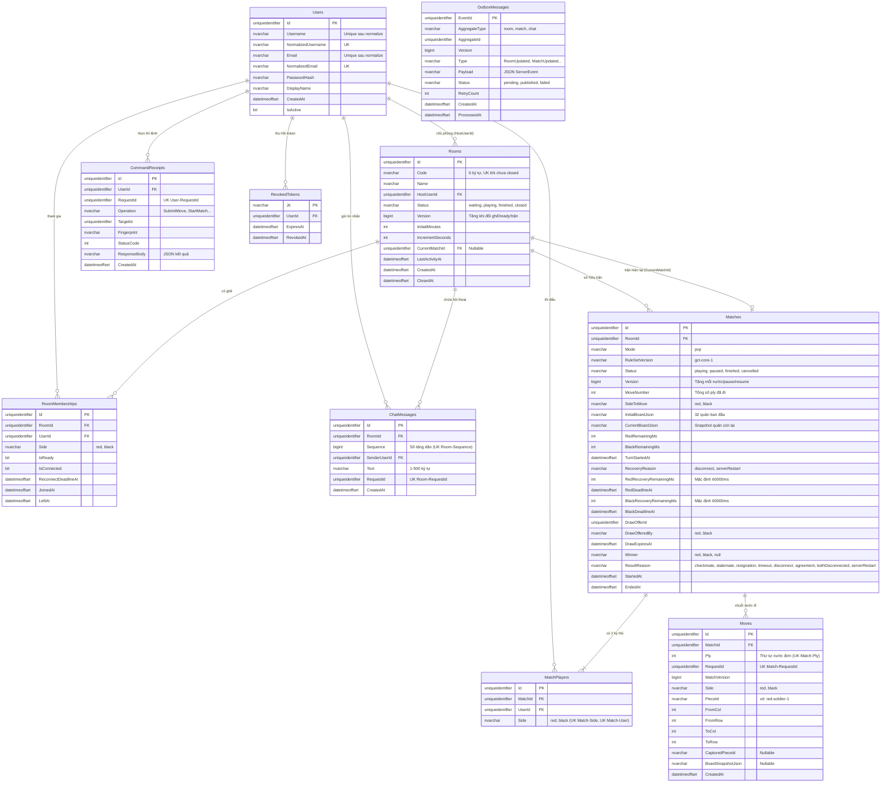

# GCT-25 — Thiết kế Cơ Sở Dữ Liệu (ERD & Data Dictionary)

Ngày thiết kế: 26/10/2026 · Tác vụ: [GCT-25](https://vle2362005.atlassian.net/browse/GCT-25) · Nhánh: `feature/GCT-25-database-erd`.

---

## 1. Mục tiêu & Phạm vi
- Cung cấp mô hình dữ liệu quan hệ hoàn chỉnh chạy trên **Microsoft SQL Server** (2019/2022/Azure SQL).
- Phục vụ lưu trữ bền vững cho tài khoản, phòng chơi, trạng thái trận đấu, chuỗi nước đi, trò chuyện, biên nhận idempotency và mẫu outbox.
- Đảm bảo các nguyên tắc bất biến:
  - **Không cascade delete**: Đóng phòng chỉ chuyển `Status = 'closed'`, không xóa trận đấu và nước đi.
  - **Chống lặp nước đi**: Ràng buộc duy nhất trên `(MatchId, Ply)` và `(MatchId, RequestId)`.
  - **Idempotency**: Bảng `CommandReceipts` ghi nhận `(UserId, RequestId)` trong cùng transaction với thay đổi dữ liệu.
  - **Nhất quán sự kiện**: Bảng `OutboxMessages` đảm bảo sự kiện phát ra Hub được lưu bền trước khi gửi.

---

## 2. Sơ đồ Thực thể - Mối quan hệ (ERD)



---

## 3. Từ điển Dữ liệu (Data Dictionary)

### 3.1. Bảng `Users`
| Tên cột | Kiểu dữ liệu | Nullable | Ràng buộc / Mặc định | Mô tả |
|---|---|---|---|---|
| `Id` | `UNIQUEIDENTIFIER` | NO | PK, Default `NEWSEQUENTIALID()` | Mã định danh người dùng (UUID) |
| `Username` | `NVARCHAR(50)` | NO | | Tên đăng nhập gốc |
| `NormalizedUsername` | `NVARCHAR(50)` | NO | UNIQUE | Tên đăng nhập chuẩn hóa (lowercase, trim) |
| `Email` | `NVARCHAR(256)` | NO | | Email người dùng |
| `NormalizedEmail` | `NVARCHAR(256)` | NO | UNIQUE | Email chuẩn hóa (lowercase, trim) |
| `PasswordHash` | `NVARCHAR(500)` | NO | | Mật khẩu băm (Identity PasswordHasher) |
| `DisplayName` | `NVARCHAR(100)` | NO | | Tên hiển thị trong phòng |
| `AvatarUrl` | `NVARCHAR(500)` | YES | | Đường dẫn ảnh đại diện (nếu có) |
| `CreatedAt` | `DATETIMEOFFSET` | NO | Default `SYSDATETIMEOFFSET()` | Thời điểm tạo tài khoản |
| `UpdatedAt` | `DATETIMEOFFSET` | NO | Default `SYSDATETIMEOFFSET()` | Thời điểm cập nhật cuối |
| `IsActive` | `BIT` | NO | Default `1` | Trạng thái kích hoạt tài khoản |

### 3.2. Bảng `Rooms`
| Tên cột | Kiểu dữ liệu | Nullable | Ràng buộc / Mặc định | Mô tả |
|---|---|---|---|---|
| `Id` | `UNIQUEIDENTIFIER` | NO | PK, Default `NEWSEQUENTIALID()` | Mã định danh phòng (UUID) |
| `Code` | `NVARCHAR(6)` | NO | Filtered UNIQUE (`Status <> 'closed'`) | Mã phòng 6 ký tự A-Z0-9 |
| `Name` | `NVARCHAR(80)` | NO | | Tên phòng chơi |
| `HostUserId` | `UNIQUEIDENTIFIER` | NO | FK `Users(Id)` | Chủ phòng (mặc định giữ ghế Đỏ) |
| `Status` | `NVARCHAR(20)` | NO | CHECK (`waiting`, `playing`, `finished`, `closed`) | Trạng thái vòng đời phòng |
| `Version` | `BIGINT` | NO | Default `1` | Số phiên bản phòng (tăng khi thay đổi) |
| `InitialMinutes` | `INT` | NO | Default `15` | Thời gian chính ban đầu (phút) |
| `IncrementSeconds` | `INT` | NO | Default `10` | Thời gian cộng thêm sau mỗi nước (giây) |
| `CurrentMatchId` | `UNIQUEIDENTIFIER` | YES | Composite FK `(CurrentMatchId, Id) -> Matches(Id, RoomId)` | Trận hiện tại (bảo đảm thuộc chính phòng đó) |
| `LastActivityAt` | `DATETIMEOFFSET` | NO | Default `SYSDATETIMEOFFSET()` | Mốc hoạt động cuối (để dọn phòng) |
| `CreatedAt` | `DATETIMEOFFSET` | NO | Default `SYSDATETIMEOFFSET()` | Thời điểm tạo phòng |
| `ClosedAt` | `DATETIMEOFFSET` | YES | | Thời điểm đóng phòng |

### 3.3. Bảng `Matches`
| Tên cột | Kiểu dữ liệu | Nullable | Ràng buộc / Mặc định | Mô tả |
|---|---|---|---|---|
| `Id` | `UNIQUEIDENTIFIER` | NO | PK, Default `NEWSEQUENTIALID()`, UK (`Id`, `RoomId`) | Mã định danh trận đấu |
| `RoomId` | `UNIQUEIDENTIFIER` | NO | FK `Rooms(Id)`, UNIQUE (`UQ_Matches_RoomId`) | Thuộc phòng nào (mỗi phòng tối đa 1 trận ở v1) |
| `Mode` | `NVARCHAR(20)` | NO | Default `pvp` | Chế độ chơi (`pvp`, `pve`) |
| `RuleSetVersion` | `NVARCHAR(50)` | NO | Default `gct-core-1` | Bộ luật áp dụng (WXF 2018 core) |
| `Status` | `NVARCHAR(20)` | NO | CHECK (`playing`, `paused`, `finished`, `cancelled`) | Trạng thái trận đấu |
| `Version` | `BIGINT` | NO | Default `1` | Phiên bản trận đấu |
| `MoveNumber` | `INT` | NO | Default `0` | Số ply đã đi trong trận |
| `SideToMove` | `NVARCHAR(10)` | NO | CHECK (`red`, `black`) | Bên tới lượt |
| `InitialBoardJson` | `NVARCHAR(MAX)` | NO | | Snapshot 32 quân lúc mở cờ |
| `CurrentBoardJson` | `NVARCHAR(MAX)` | NO | | Snapshot các quân cờ hiện tại |
| `RedRemainingMs` | `INT` | NO | | Đồng hồ còn lại của Đỏ (ms) |
| `BlackRemainingMs` | `INT` | NO | | Đồng hồ còn lại của Đen (ms) |
| `TurnStartedAt` | `DATETIMEOFFSET` | YES | | Mốc bắt đầu lượt (NULL khi paused) |
| `RecoveryReason` | `NVARCHAR(20)` | YES | CHECK (`disconnect`, `serverRestart`) | Lý do dừng phục hồi |
| `RedRecoveryRemainingMs`| `INT` | NO | Default `60000` | Ngân sách nối lại còn lại của Đỏ (ms) |
| `RedDeadlineAt` | `DATETIMEOFFSET` | YES | | Hạn chót nối lại của Đỏ |
| `BlackRecoveryRemainingMs`| `INT`| NO | Default `60000` | Ngân sách nối lại còn lại của Đen (ms) |
| `BlackDeadlineAt` | `DATETIMEOFFSET` | YES | | Hạn chót nối lại của Đen |
| `DrawOfferId` | `UNIQUEIDENTIFIER` | YES | | Mã đề nghị hòa đang hiệu lực (30s) |
| `DrawOfferedBy` | `NVARCHAR(10)` | YES | | Bên đề nghị hòa (`red`, `black`) |
| `DrawExpiresAt` | `DATETIMEOFFSET` | YES | | Thời điểm đề nghị hòa hết hạn |
| `Winner` | `NVARCHAR(10)` | YES | CHECK (`red`, `black`, NULL) | Bên chiến thắng |
| `ResultReason` | `NVARCHAR(30)` | YES | CHECK theo BR-09 & Schema | Lý do kết thúc trận |
| `StartedAt` | `DATETIMEOFFSET` | NO | Default `SYSDATETIMEOFFSET()` | Thời điểm bắt đầu trận |
| `EndedAt` | `DATETIMEOFFSET` | YES | | Thời điểm kết thúc trận |

### 3.4. Bảng `Moves`
| Tên cột | Kiểu dữ liệu | Nullable | Ràng buộc / Mặc định | Mô tả |
|---|---|---|---|---|
| `Id` | `UNIQUEIDENTIFIER` | NO | PK, Default `NEWSEQUENTIALID()` | Mã bản ghi nước đi |
| `MatchId` | `UNIQUEIDENTIFIER` | NO | FK `Matches(Id)` (NO ACTION) | Thuộc trận đấu nào |
| `Ply` | `INT` | NO | UNIQUE (`MatchId`, `Ply`) | Số thứ tự nước đơn (1, 2, 3...) |
| `RequestId` | `UNIQUEIDENTIFIER` | NO | UNIQUE (`MatchId`, `RequestId`) | Mã request idempotency |
| `MatchVersion` | `BIGINT` | NO | | Phiên bản trận sau khi đi nước này |
| `Side` | `NVARCHAR(10)` | NO | CHECK (`red`, `black`) | Màu quân đi |
| `PieceId` | `NVARCHAR(32)` | NO | | Mã quân đi (`red-soldier-1`...) |
| `FromCol`, `FromRow` | `INT` | NO | CHECK (0..8, 0..9) | Tọa độ xuất phát |
| `ToCol`, `ToRow` | `INT` | NO | CHECK (0..8, 0..9) | Tọa độ đích đến |
| `CapturedPieceId` | `NVARCHAR(32)` | YES | | Quân bị ăn (nếu có) |
| `CreatedAt` | `DATETIMEOFFSET` | NO | Default `SYSDATETIMEOFFSET()` | Thời điểm ghi nhận nước đi |

---

## 4. Hướng dẫn thực thi trên SQL Server

Hệ thống cung cấp 2 file script riêng biệt nằm tại thư mục `docs/database/`:
- [`docs/database/schema.sql`](schema.sql): Script khởi tạo cấu trúc cơ sở dữ liệu. **Hoàn toàn an toàn, có tính Idempotent** (không chứa lệnh `DROP TABLE`, kiểm tra trước khi tạo bảng/chỉ mục, không làm mất dữ liệu khi chạy lại nhiều lần).
- [`docs/database/reset.sql`](reset.sql): Script dọn dẹp sạch toàn bộ 10 bảng theo đúng thứ tự ràng buộc khóa ngoại (Foreign Keys). **Chỉ dùng khi cần dọn sạch môi trường test/dev để tạo lại từ đầu**.

### 4.1. Khởi tạo / cập nhật database (`schema.sql`):
1. **Qua SQL Server Management Studio (SSMS) / Azure Data Studio**:
   - Mở SSMS $\rightarrow$ Kết nối tới SQL Server instance (`.\SQLEXPRESS` hoặc `localhost`).
   - Mở file `docs/database/schema.sql`.
   - Bấm **Execute** (`F5`).
2. **Qua PowerShell bằng `sqlcmd`**:
   ```powershell
   sqlcmd -S ".\SQLEXPRESS" -E -C -i docs/database/schema.sql
   ```
3. Sau khi thực thi:
   - Database `GameCoTuong` được tạo với collation `Vietnamese_100_CI_AS_SC_UTF8`.
   - Cấu trúc hoàn chỉnh gồm: **10 bảng tổng cộng**, **12 khóa ngoại** (tất cả đều được cấu hình `ON DELETE NO ACTION` - không cascade delete; bao gồm Composite FK đồng phòng giữa `Rooms` và `Matches`) và **4 chỉ mục có bộ lọc** (Filtered Indexes).
   - Đã tạo dữ liệu mẫu cho 2 tài khoản `kythu_do` và `kythu_den` (chưa xác nhận đăng nhập vì PasswordHash hiện vẫn là placeholder).

### 4.2. Dọn sạch database khi cần làm mới (`reset.sql`):
```powershell
sqlcmd -S ".\SQLEXPRESS" -E -C -i docs/database/reset.sql
```

---

## 5. Kết quả kiểm thử thực nghiệm trên Microsoft SQL Server

### 5.1. Môi trường kiểm thử thực tế
- **Hệ quản trị CSDL**: `Microsoft SQL Server 2025 (RTM) - 17.0.1000.7 (X64)`
- **Phiên bản chi tiết**: `Express Edition (64-bit) on Windows 10 Home 10.0 <X64> (Build 26200)`
- **Collation**: `Vietnamese_100_CI_AS_SC_UTF8`
- **Bộ công cụ thực thi**: `sqlcmd` (với tùy chọn mã hóa an toàn `-C` TrustServerCertificate)

### 5.2. Các kịch bản kiểm nghiệm đã chạy thành công

| Kịch bản | Mục đích kiểm tra | Lệnh thực hiện | Kết quả thực tế trên SQL Server |
|---|---|---|---|
| **1. Khởi tạo trên database trống** | Chạy `schema.sql` trên database vừa reset sạch | `sqlcmd -S ".\SQLEXPRESS" -E -C -i docs/database/schema.sql` | **Thành công (0 lỗi)**: Tạo đủ 10 bảng tổng cộng, 12 khóa ngoại, 4 filtered indexes, chèn riêng từng tài khoản Đỏ/Đen. |
| **2. Chạy lại schema (Idempotency)** | Chạy lại `schema.sql` trên database đã có dữ liệu | `sqlcmd -S ".\SQLEXPRESS" -E -C -i docs/database/schema.sql` | **Thành công (0 lỗi)**: Giữ nguyên 100% bảng và dữ liệu hiện có, không drop bảng, không trùng lặp seed data. |
| **3. Seed khi thiếu từng tài khoản** | Xóa riêng tài khoản Đỏ hoặc Đen rồi chạy lại khối seed | Xóa `KYTHU_DO` $\rightarrow$ Chạy seed<br>Xóa `KYTHU_DEN` $\rightarrow$ Chạy seed | **Thành công (0 lỗi)**: Bổ sung chính xác tài khoản bị thiếu; không bỏ sót và không xảy ra lỗi trùng khóa với tài khoản còn lại. |
| **4. Từ chối tạo hai trận cùng phòng** | Cố tình INSERT trận thứ hai có cùng `RoomId` của phòng đã có trận | `INSERT INTO dbo.Matches (RoomId, ...)` với `RoomId` đã tồn tại | **Database từ chối thành công**: Báo lỗi `Violation of UNIQUE KEY constraint 'UQ_Matches_RoomId'`. Mỗi phòng chỉ có duy nhất 1 trận ở v1. |
| **5. Từ chối gán trận sai phòng** | Cố tình UPDATE `Rooms(Phòng A).CurrentMatchId = Trận của Phòng B` | `UPDATE dbo.Rooms SET CurrentMatchId = @MatchBId WHERE Id = @RoomAId` | **Database từ chối thành công**: Báo lỗi `The UPDATE statement conflicted with the FOREIGN KEY constraint "FK_Rooms_Matches_CurrentMatchId"` do vi phạm composite FK `(CurrentMatchId, Id) -> (Id, RoomId)`. |
| **6. Gán trận đúng phòng hợp lệ** | UPDATE `Rooms(Phòng A).CurrentMatchId = Trận của Phòng A` | `UPDATE dbo.Rooms SET CurrentMatchId = @MatchAId WHERE Id = @RoomAId` | **Thành công (1 row affected)**: Cập nhật hợp lệ khi trận đấu thuộc chính phòng đó. |
| **7. Ràng buộc không Cascade Delete** | Kiểm tra toàn bộ 12 khóa ngoại không tự động xóa dây chuyền | `SELECT delete_referential_action_desc FROM sys.foreign_keys` | **12/12 FK đạt `NO_ACTION`**, bảo vệ toàn vẹn lịch sử trận đấu và nước đi khi phòng đóng. |
| **8. Chỉ mục có bộ lọc (Filtered Index)** | Kiểm tra 4 filtered index cho mã phòng, ghế hoạt động và outbox pending | `SELECT name, filter_definition FROM sys.indexes WHERE has_filter = 1` | **Đạt 4/4**: `UQ_Rooms_ActiveCode` (`Status <> 'closed'`), `UQ_RoomMemberships_Room_Side_Active`, `UQ_RoomMemberships_User_Active`, `IX_OutboxMessages_Pending`. |
| **9. Trạng thái tài khoản Seed** | Kiểm tra tài khoản mẫu đã chuẩn hóa username/email | `SELECT Username, NormalizedUsername, Email FROM dbo.Users` | **Đã tạo dữ liệu mẫu, chưa xác nhận đăng nhập** (vì `PasswordHash` hiện vẫn là placeholder cho môi trường test/dev). |

