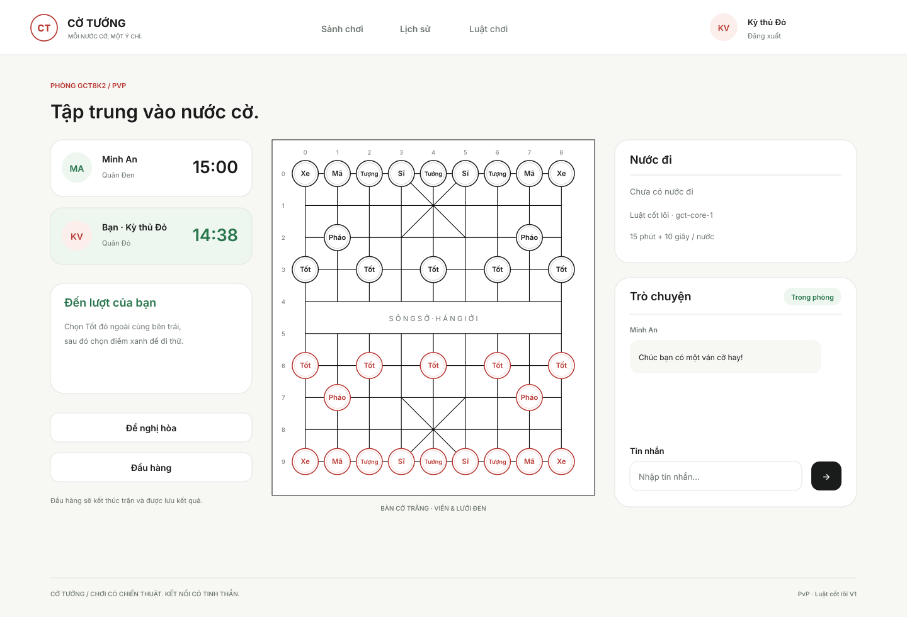

# GCT-24 — Màn hình và luồng sử dụng

Bàn giao thiết kế ngày 27/10/2026. Bản mẫu phục vụ review thao tác trước khi GCT-32 triển khai Vue Router, trạng thái ứng dụng và API client.

## Xem và thử

- Tải [prototype.html](prototype.html), mở trực tiếp bằng Chrome hoặc Edge. File tự chứa toàn bộ giao diện và JavaScript, không cần cài package hay chạy server.
- Chọn một trong **27 kịch bản** ở thanh review phía trên để xem ngay màn hình/trạng thái tương ứng.
- Thử luồng chính: nhập username bất kỳ từ 3 ký tự và mật khẩu minh họa từ 8 ký tự → Đăng nhập → Tạo phòng → bấm **Đối thủ vào & sẵn sàng** ở thanh giả lập → Tôi đã sẵn sàng → Bắt đầu.
- Trong trận, bấm Tốt Đỏ ở cột 0 hàng 6 rồi điểm xanh ở hàng 5 để thử **một nước minh họa**. Bộ luật hoàn chỉnh được xây dựng ở các thẻ engine.
- Thanh trên cùng giả lập sự kiện từ bên còn lại/máy chủ. Chúng là công cụ review, không thuộc giao diện sản phẩm.
- Nút **Tải SVG màn hình** xuất bản vector đang xem. Các [SVG có sẵn](screens/) đều gồm chữ, đường và hình có thể chỉnh sửa; có thể kéo vào Figma/Inkscape để chỉnh tiếp.

Tên người chơi và dữ liệu trận là dữ liệu minh họa. Thông tin nhập không gửi đi, không được ghi vào localStorage hay cookie. Dùng dữ liệu giả để review.

## Màn hình chính

| Màn hình | Bản vẽ | Nội dung |
|---|---|---|
| Đăng nhập | [01](screens/01-login.svg) | Nhập thông tin, đăng ký, thông báo lỗi/hết phiên |
| Đăng ký | [02](screens/02-register.svg) | Username, email, mật khẩu, xác nhận và quay lại đăng nhập |
| Sảnh | [03](screens/03-lobby.svg) | Tạo phòng, danh sách, bộ lọc thời gian và tham gia bằng mã |
| Phòng chờ — chủ | [04](screens/04-host-waiting.svg), [05](screens/05-host-ready.svg) | Ghế, sẵn sàng, điều kiện Bắt đầu, Rời/Đóng phòng |
| Phòng chờ — khách | [06](screens/06-guest-ready.svg) | Sẵn sàng, Rời phòng, chờ chủ bắt đầu |
| Bàn cờ | [07](screens/07-match.svg), [08](screens/08-move-confirmed.svg) | Lượt, đồng hồ, nước đã xác nhận, chat, hòa, đầu hàng |
| Kết quả | [11](screens/11-result-win.svg), [12](screens/12-result-draw.svg), [13](screens/13-result-cancelled.svg) | Thắng/thua/hòa/hủy được phân biệt; lịch sử, tạo phòng mới, về sảnh |
| Lịch sử và chi tiết | [14](screens/14-history.svg), [27](screens/27-history-detail.svg) | Danh sách kết quả và snapshot trận đã lưu |



## Yêu cầu hình thức

- Bàn cờ nền **#FFFFFF**, viền và lưới **#000000**, 9 cột × 10 hàng, có sông và hai cửu cung.
- Đen ở hàng 0 phía trên, Đỏ ở hàng 9 phía dưới; 32 quân khởi đầu, tên quân tiếng Việt để dễ đọc.
- Card bo góc 20–28px; thông báo 18px; nút và ô nhập 12–13px. Bàn cờ giữ góc vuông.
- Nền sáng #F7F7F4, chữ #191C1A; đỏ #B7352F cho thương hiệu/quân Đỏ, xanh #28754C cho trạng thái hợp lệ.
- Kiểu chữ Inter / Segoe UI / DejaVu Sans; không tải font hoặc tài nguyên ngoài.
- Bản thiết kế desktop rộng 1440px. File mẫu cuộn ngang trên màn hình hẹp; bản Vue responsive thuộc bước triển khai tiếp theo.

## Các trạng thái và đường ra

| Tình huống | Bản vẽ | Hành động để tiếp tục |
|---|---|---|
| Đang tải | [17](screens/17-loading.svg) | Thử tải lại hoặc quay lại |
| Sảnh rỗng | [16](screens/16-lobby-empty.svg) | Tạo phòng mới hoặc về sảnh |
| Lịch sử rỗng | [15](screens/15-history-empty.svg) | Tạo phòng hoặc về sảnh |
| Lỗi tải dữ liệu | [18](screens/18-error.svg) | Thử tải lại hoặc quay lại |
| Sai thông tin đăng nhập | [23](screens/23-login-error.svg) | Kiểm tra thông tin và đăng nhập lại |
| Phiên hết hạn | [24](screens/24-session-expired.svg) | Đăng nhập lại, lấy snapshot trước khi tiếp tục |
| Phòng chờ mất mạng | [19](screens/19-room-offline.svg) | Nối lại; reset sẵn sàng, không tự bắt đầu |
| Mất mạng trong trận | [09](screens/09-reconnect.svg) | Giữ bàn/lượt/đồng hồ, chặn đi quân/hòa; nối lại và đồng bộ |
| Máy chủ khởi động lại | [10](screens/10-restart.svg) | Chờ phục hồi và xác thực; thất bại là hủy, không tự trao thắng |
| Đối thủ đề nghị hòa | [20](screens/20-incoming-draw.svg) | Chấp nhận hoặc tiếp tục đấu; offer hết hiệu lực sau 30s |
| Đầu hàng | [21](screens/21-confirm-resign.svg) | Xác nhận kết thúc hoặc tiếp tục ở lại |
| Đóng phòng / khách rời | [22](screens/22-confirm-close.svg), [26](screens/26-confirm-leave.svg) | Xác nhận hoặc hủy; dữ liệu trận đã lưu được giữ lại |
| Chưa có đối thủ | [25](screens/25-room-empty-seat.svg) | Giữ ghế trống và khóa Bắt đầu |

## Quyền và chuyển trạng thái

| Trạng thái | Chủ phòng | Khách |
|---|---|---|
| waiting | Đổi sẵn sàng; Bắt đầu khi đủ hai người ready/online; Rời/Đóng có xác nhận | Đổi sẵn sàng; Rời có xác nhận; không có Bắt đầu/Đóng |
| playing | Đi đúng lượt; chat; đề nghị hòa; Đầu hàng có xác nhận | Cùng quyền trong trận theo đúng bên/lượt |
| paused | Khóa đi quân và hòa; vẫn có thể chat/đầu hàng nếu kết nối máy chủ còn hợp lệ | Như chủ phòng |
| finished/cancelled | Xem kết quả/lịch sử; rời hoặc đóng; tạo phòng mới cho trận khác | Xem kết quả/lịch sử; rời; tạo phòng mới |

Trong trận không có nút Rời/Đóng. Điều hướng về sảnh bị chặn và hướng dẫn Đầu hàng. Từ phòng chờ/kết quả, điều hướng rời phòng phải xác nhận. Trận hủy không cộng vào số trận hòa. Mỗi phòng chỉ dùng cho một trận v1; luồng tạo trận tiếp theo rời/đóng phòng cũ trước khi tạo phòng mới.

## Quan hệ và nguồn đầu vào

- [GCT-24](https://vle2362005.atlassian.net/browse/GCT-24) thuộc Epic GCT-14, bị GCT-19 chặn và chặn GCT-32.
- [GCT-19](https://vle2362005.atlassian.net/browse/GCT-19): phạm vi v1, yêu cầu nghiệp vụ và giới hạn luật.
- [GCT-15 — lifecycle](https://github.com/vle2362005-collab/Game-Co-Tuong/blob/8e28febd7b818f2d60e44f43b0415b053cc9c21b/docs/lifecycle.md): R01–R13, M01–M19; tham chiếu thiết kế bổ sung, không tự thêm quan hệ Jira.
- [GCT-20 — contracts](https://github.com/vle2362005-collab/Game-Co-Tuong/blob/81f65ca67af35adff8c0dbb4d82e7953a3b9b4e0/docs/contracts.md): dữ liệu/sự kiện, version, requestId và reconnect.
- [Bàn giao GCT-32](handoff.md): ràng buộc cần giữ khi nối API.

## Kiểm tra và giới hạn

Chạy từ root repository, dùng Node 24 theo cấu hình chung:

```sh
node docs/design/GCT-24/build.mjs
node docs/design/GCT-24/check.mjs
```

Đã đạt **28 kiểm tra** mô hình tương tác, quyền, cấu trúc SVG và cú pháp script; 27/27 SVG parse XML và render được. Đã xem hình các màn hình và sửa chồng tiêu đề/thông báo. Đây không phải kết quả kiểm thử backend, SQL Server hay engine. Chưa thực hiện kiểm thử tương tác bằng trình duyệt trong môi trường xây dựng này vì bộ Chromium tải về không hợp lệ.

File Figma mới đã được tạo nhưng gói Starter chạm giới hạn MCP trước khi ghi được màn hình. Bộ bàn giao hoàn chỉnh của lần này là HTML/SVG và mã nguồn trong thư mục này; không ghi nhận file Figma trống là thiết kế đã hoàn thành.

GCT-24 chờ trưởng nhóm review và merge PR. GCT-32 tiếp tục xây dựng giao diện Vue, responsive, gọi API/SignalR thật và kiểm thử tích hợp.
