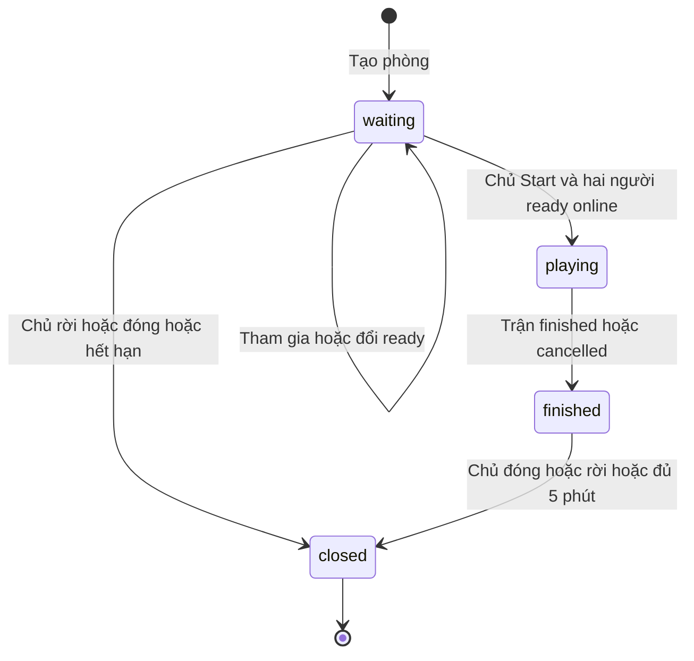
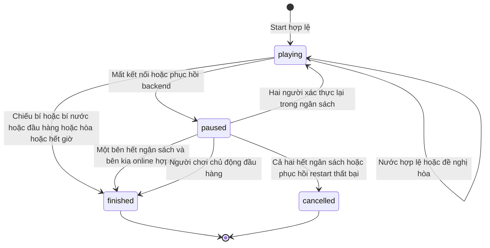

# GCT-15 — Vòng đời phòng và trận đấu

26/10/2026 · [Jira GCT-15](https://vle2362005.atlassian.net/browse/GCT-15) · Nhánh `feature/GCT-15-project-foundation`.

Đầu vào: [GCT-19 requirements.md](requirements.md), BR-01–11. Tài liệu này là thiết kế để review, chưa phải service đã triển khai. Hai sơ đồ dưới có bản Mermaid độc lập trong thư mục `diagrams/`.

## 1. Phòng

“Ready” là điều kiện `waiting && players=2 && allReady && allConnected`, không là một trạng thái room lưu riêng. Room vẫn `playing` khi match `paused`, nên không bị Join hoặc cleanup nhầm. Khách rời/mất mạng trước Start làm cả hai chưa ready; không thể vừa thay người vừa Start bằng dữ liệu cũ.

| ID | Đầu | Tác nhân / điều kiện | Sau | Tác dụng bền / từ chối |
|---|---|---|---|---|
| R01 | Chưa tồn tại | User đã đăng nhập, không ở phòng chưa đóng | waiting | Mã sáu ký tự unique, host Đỏ, ready=false, chưa có match |
| R02 | waiting | User khác, ghế Đen trống, không giữ ghế phòng khác | waiting | Thêm guest, reset ready cả hai; tranh ghế khóa room |
| R03 | waiting | Thành viên online đổi ready của mình | waiting | Chỉ sửa đúng người; broadcast snapshot |
| R04 | waiting + ready | Chủ Start, cả hai còn online và ready tại thời điểm khóa | playing | Cùng transaction: một match version=1, room playing, receipt, outbox |
| R05 | waiting | Guest Leave hoặc offline đủ 60 giây | waiting | Giải phóng ghế guest, reset ready; không tạo match |
| R06 | waiting | Host Leave/Close hoặc offline đủ 60 giây | closed | Giải phóng membership, không chuyển host |
| R07 | waiting | Người mất mạng quay lại trước deadline | waiting | Giữ ghế, reset ready; phải xác nhận lại, không auto Start |
| R08 | waiting | Không có thao tác thành công 15 phút, không còn cửa sổ reconnect | closed | Poll GET không gia hạn; Join/Ready thành công cập nhật lastActivityAt |
| R09 | playing | Match vừa terminal trong cùng transaction | finished | Giữ currentMatchId và MatchPlayers; không đổi danh tính trận |
| R10 | finished | Guest Leave | finished | Bỏ membership hiện tại; quyền đọc lịch sử vẫn theo MatchPlayers |
| R11 | finished | Host Leave/Close hoặc 5 phút sau endedAt | closed | Giải phóng membership còn lại, giữ match/moves/result |
| R12 | playing | Leave/Close/Join/Ready/Start | Giữ nguyên | INVALID_STATE; muốn bỏ trận dùng Resign, không xóa phòng đang chơi |
| R13 | closed | Join/Ready/Start/Chat | Giữ nguyên | ROOM_CLOSED; đọc lịch sử dùng endpoint trận, không hồi sinh room |

Reset ready hoặc thay đổi presence tăng room.version; nếu đổi cả room và match thì mỗi aggregate tăng một lần. SetReady cùng giá trị và Join lại của đúng thành viên là no-op thành công sau kiểm tra version, không thêm ghế/version/event. Một user rời finished để tạo phòng mới phải bỏ membership cũ trước.

## 2. Trận đấu

| ID | Đầu | Điều kiện / lệnh | Sau và kết quả |
|---|---|---|---|
| M01 | Chưa có | R04 thành công | playing, Đỏ tới lượt, 32 quân, clock bắt đầu, mỗi bên 60000ms reconnect |
| M02 | playing | Move đúng user/lượt/version/luật và chưa hết giờ | playing; một ply; cập nhật clock/board, hủy pendingDraw |
| M03 | playing | Sau Move, bên tới lượt không còn nước hợp lệ | finished; winner=bên vừa đi; checkmate nếu bị chiếu, stalemate nếu không |
| M04 | playing/paused | Người chơi hợp lệ Resign | finished, winner=đối thủ, reason=resignation; nếu deadline đã quyết định kết quả thì trả trạng thái cuối |
| M05 | playing | Đồng hồ bên tới lượt hết | finished, winner=đối thủ, reason=timeout |
| M06 | playing | Mất kết nối hợp lệ cuối của một bên | paused; chốt phần clock đã dùng, turnStartedAt=null, hủy pendingDraw; mở deadline từ ngân sách còn lại |
| M07 | paused | Người còn lại cũng offline | paused; mở deadline riêng, không reset deadline người vắng trước |
| M08 | paused/disconnect | Reconnect trước deadline đúng user, còn ngân sách | Trừ thời gian đã offline; nếu cả hai hợp lệ thì playing, nếu chưa đủ thì paused |
| M09 | paused/disconnect | A hết ngân sách, B online hợp lệ | finished, winner=B, reason=disconnect |
| M10 | paused/disconnect | A hết ngân sách, B vẫn offline còn thời hạn | paused; không tự chọn thắng; chờ B phục hồi hoặc hết hạn |
| M11 | paused/disconnect | Cả hai hết ngân sách | cancelled, winner=null, reason=bothDisconnected |
| M12 | Đang lưu playing/paused | Backend khởi động và lấy quyền một instance | paused/serverRestart; phục hồi snapshot, giữ ngân sách cũ, yêu cầu hai user xác thực lại |
| M13 | paused/serverRestart | Cả hai phục hồi trước deadline mỗi bên | playing; bàn/lượt/clock checkpoint cũ; trừ ngân sách đã dùng |
| M14 | paused/serverRestart | Một bên hết hạn không thể phục hồi | cancelled, winner=null, reason=serverRestart; không trao thắng dù bên kia online |
| M15 | playing/PvP | OfferDraw, không có đề nghị còn hiệu lực | playing; offerId + offeredBy + createdAt + expiresAt=+30s; clock vẫn chạy |
| M16 | playing/PvP | Đối thủ Accept đúng offerId còn hiệu lực | finished, winner=null, reason=agreement |
| M17 | playing/PvP | Đối thủ Decline, hết hạn hoặc Move mới | playing; xóa pendingDraw; offer cũ không thể Accept |
| M18 | paused | Move hoặc Offer/Accept/DeclineDraw | Giữ nguyên; MATCH_PAUSED; đọc/sync/chat vẫn được; Resign theo M04 |
| M19 | finished/cancelled | Move/Resign/Draw/Resume mới | Giữ nguyên; MATCH_ENDED; retry cùng requestId đã thành công trả receipt cũ |

`finished` gồm thắng/thua và hòa thỏa thuận; `cancelled` là không có kết quả thi đấu, không được tính là hòa. Mọi terminal cập nhật room finished, stopped clock, endedAt và result trong cùng transaction; không xóa snapshot cuối hoặc nước đi.

## 3. Ngân sách nối lại và khởi động lại

Mỗi bên lưu `remainingMs`, `disconnectedAt`, `deadlineAt`. Khi offline: `deadlineAt = disconnectedAt + remainingMs`; số dư hiển thị tại t là `max(0, remainingMs - (t-disconnectedAt))`. Khi trở lại đúng hạn, lưu số dư mới và đặt hai timestamp null. Online không tiêu ngân sách; paused vẫn trừ ngân sách của người đang offline. Ví dụ offline 20s rồi 15s thì còn 25s, không nhận thêm 60s.

At deadline là quá hạn: timeout worker và reconnect cùng khóa room → match, đọc lại presence, version, serverTime và deadline. Worker cũ không được xử thua sau khi reconnect đã commit. Reconnect trễ chỉ được xem trạng thái, không được khôi phục quyền chơi; worker xét M09–11. Event bị lặp không tự tạo lần pause/resume mới.

Sau crash, dùng clock checkpoint cuối đã commit. Người đã offline giữ thời điểm và deadline, gồm thời gian outage; người trước crash online bắt đầu cửa sổ phục hồi tại thời điểm startup bằng số dư cũ. Lưu recovery marker bền; restart thêm lần nữa giữ deadline đang mở, không reset ngân sách. Khi cả hai phục hồi, đặt lại turnStartedAt bằng giờ server hiện tại. Nếu đã terminal thì không áp dụng M12. Phòng waiting được áp dụng grace 60s và cleanup như trước trận, không tùy ý xóa ngay tất cả phòng khi restart.

## 4. Đồng thời, lỗi lưu và kiểm tra

Thứ tự command: xác thực → receipt cùng user/requestId → transaction room/match → kiểm version → xử lý deadline/clock đã đến → quyền/trạng thái/luật → lưu + outbox + receipt → commit → phản hồi/phát sự kiện. Thắng giữa AcceptDraw/Move/Resign được quyết định bởi trạng thái đã khóa; terminal không bị ghi lần hai. Nếu đề nghị đã hết hạn nhưng worker chưa dọn, handler vẫn từ chối Accept.

Hủy do cả hai mất mạng hoặc restart là hành động máy chủ, không có endpoint cho một người tùy ý hủy trận đang chơi. Đóng phòng trước Start là hủy phòng chờ, không tạo bản ghi trận giả.

Đối chiếu các ca AC-02–16 trong requirements.md. Khi có backend, phải thử mốc deadline±1ms, hai Start, hai nước đồng thời, nhiều tab, reconnect cạnh tranh worker, Accept cạnh tranh Move, cleanup chạy lặp và restart sau commit. Đóng GCT-15 khi sơ đồ/bảng điều kiện đã được trưởng nhóm review; chưa đánh dấu các ca tích hợp là pass chỉ vì thiết kế có đủ nhánh.
